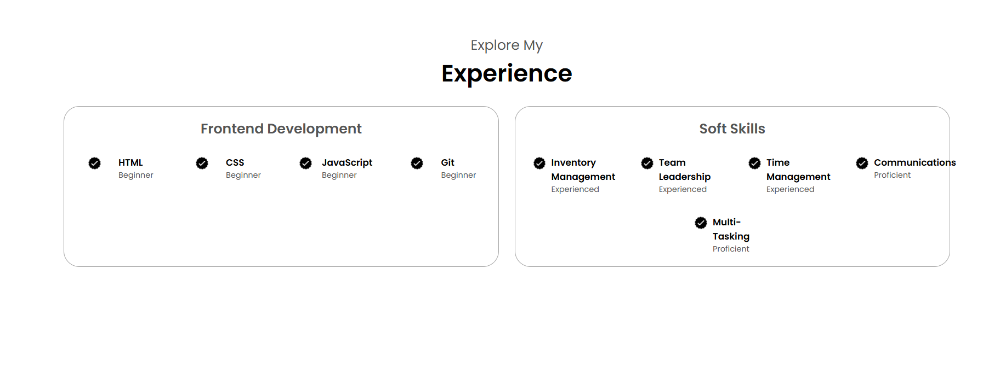

# Zackery Clayton Portfolio

A responsive personal portfolio website built with HTML, CSS, and JavaScript.

This portfolio showcases my journey into front-end development through hands-on projects, responsive design principles, and continuous learning. It highlights both my technical growth and the professional experience I've gained through leadership, customer service, and operations roles.

## Live Demo

[View Portfolio](https://zack-portfilio.wasmer.app/)

## Screenshot



## Features

- Responsive desktop and mobile layouts
- Hamburger navigation menu
- Smooth scrolling navigation
- Resume download
- GitHub and LinkedIn integration
- Project showcase section
- Contact section


## Built With

- HTML5
- CSS3
- JavaScript
- Git
- GitHub

## Project Structure

```text
html-css-js-Portfoilio-Zack/
├── index.html
├── style.css
├── mediaqueries.css
├── script.js
└── assets/
```

## Featured Projects

### Portfolio Website

A responsive portfolio designed to showcase my skills, projects, and growth as a developer.

### Rock Paper Scissors

A browser-based game that demonstrates JavaScript fundamentals including event handling, DOM manipulation, score tracking, and game logic.

Repository:
https://github.com/Zackmadness/RockPaperSiccors

### Calculator

A calculator application built using HTML, CSS, and JavaScript, focused on user interaction, mathematical operations, and clean UI design.

Repository:
https://github.com/Zackmadness/Calculator

### Odin Recipes

A multi-page recipe website built while completing The Odin Project curriculum, emphasizing semantic HTML and strong web development foundations.

Repository:
https://github.com/Zackmadness/odin-recipes

## About Me

I'm an aspiring front-end developer with a background in customer service, retail operations, and team leadership. I'm currently focused on expanding my web development skills through project-based learning and continuous improvement.

My goal is to build responsive, accessible, and user-friendly web applications while growing into a professional software development role.

## Connect With Me

- GitHub: https://github.com/Zackmadness
- LinkedIn: https://www.linkedin.com/in/zackery-clayton-b84188277/
- Email: zclayton22@gmail.com

## Future Improvements

- Additional JavaScript projects
- API-powered applications
- Enhanced accessibility
- Dark mode theme
- Live demos for all projects
- Expanded project showcase

---

Built by Zackery Clayton
